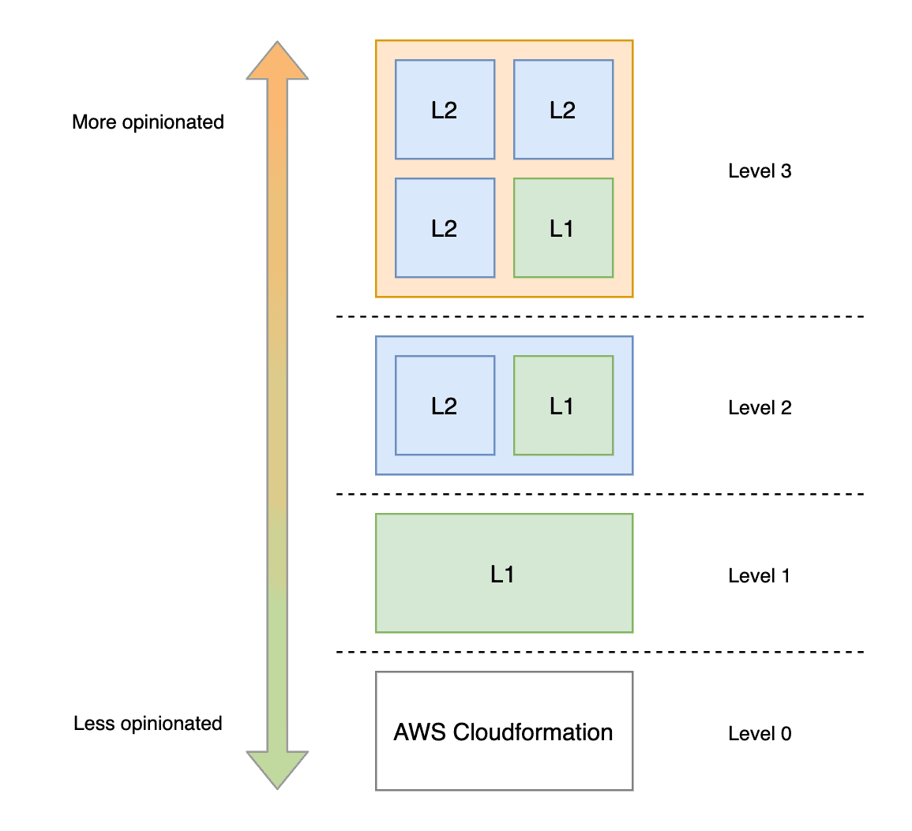

# CDK Overview

The AWS Cloud Development Kit (CDK) is a software development framework for defining cloud infrastructure in code and provisioning it through AWS CloudFormation. 

Since managing infrastructure through AWS CloudFormation can be a complex and error-prone task due to its verbose JSON or YAML syntax, it often requires a deep understanding of the resources and their dependencies, making it difficult for developers to set up and manage AWS resources.

CDK simplifies this process by providing abstraction layers, allowing developers to define their infrastructure using programming languages and it's conventions. This makes it easier to create, configure, and manage AWS resources, reducing the complexity and increasing the efficiency of infrastructure management.

    tldr; CDK takes code, turns it into CloudFormation JSON templates, and deploys it to create resources.

Please take a look at [CDK's Best Practices Guide](https://github.com/awsdocs/aws-cdk-guide/blob/main/v2/best-practices.md) for more information. 

## Constructs

Constructs are the basic building blocks of AWS CDK apps. A construct represents a "cloud component" and encapsulates everything AWS CloudFormation needs to create the component.

A construct can represent a single resource, such as an Amazon S3 Bucket or an Amazon SNS Topic, a higher-level component consisting of multiple AWS CDK resources, or even a portion of an app. You can also use constructs to model multi-stack applications, as well as create and share your own abstractions.

The AWS CDK includes a library of constructs that represent AWS resources. You can begin from forming actual CFN templates in YAML or JSON, to using python to create L1 all the way to L3 constructs (different topic).

- L1 Constructs - a low-level Cfn resource where you must configure **all** of the resource properties 
- L2 Constructs - a higher-level intent-based resource where **convenient** defaults, boilerplates, and glue logic are provided
- L3 Constructs - "patterns" where this is designed to complete common tasks or deploy architecture patterns (usually involving multiple types of resources)

It is _possible_ that a mix of L2/L1 constructs can be used to configure things to a team's desire. We leverage L2 constructs (_mostly_) to ensure we don't have to implement sane defaults or best practices explicitly. This project uses a mix of L2 and L1 constructs, putting us at **Level 2** (in the chart below).

Although what this project is building _can constitute_ as an L3 construct, since we're not providing a "pattern", _technically_ this isn't an L3 construct.

## Stacks 

In AWS CDK, a Stack is a unit of deployment and a first-class construct in AWS CDK. Each Stack is defined within an AWS CDK app and can be used to define a unit of functionality or resources that are deployed together. 

A Stack can contain any number of constructs but it's common to define resources that have a lifecycle together. For example, you might define a VPC, an ECS Cluster, and an RDS Database instance in the same Stack because they are all related and have a lifecycle that is managed together.

Stacks are also used to separate out different environments (like dev, staging, prod) because each Stack is deployed independently and can be managed separately. This allows you to manage and version your infrastructure at the granularity that makes sense for your use case.

When a CDK app is synthesized, each Stack is compiled down to a separate AWS CloudFormation template. This allows you to use the AWS CloudFormation service to deploy and manage your AWS resources.

It's important to note that while Stacks provide a way to group related resources, they do not create any additional resources or have any impact on the resources that are defined within them. **They are simply a logical grouping mechanism.**

In terms of the relationship between Stacks and Constructs, you can think of a Stack as a special type of Construct. Just like any other Construct, a Stack can contain other Constructs. However, unlike other Constructs, a Stack also represents a deployment unit and is associated with an AWS CloudFormation template.

## Synthesize

Synthesizing in AWS CDK is the process of converting the code written in a programming language into a CloudFormation template. This template, written in JSON or YAML, is what AWS CloudFormation uses to create and manage AWS resources. The `cdk synth` command is used to perform this operation. It's a crucial step in the CDK workflow as it bridges the gap between the high-level code and the low-level AWS CloudFormation templates.

## Deployment

---

## Development Flow

This is how the process works to make things "easier", and we use `Makefiles` to ensure certain settings and configurations are being used during development. Please follow the [Getting Started](../README.md#getting-started) section for more details.

---

## Deployment Flow

We organize the CDK project in the following decision chart to ensure a self-installing mechanism works with the least amount of complexity and troubleshooting required during development processes.

