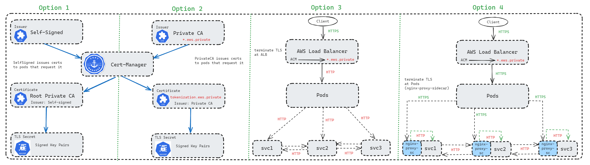
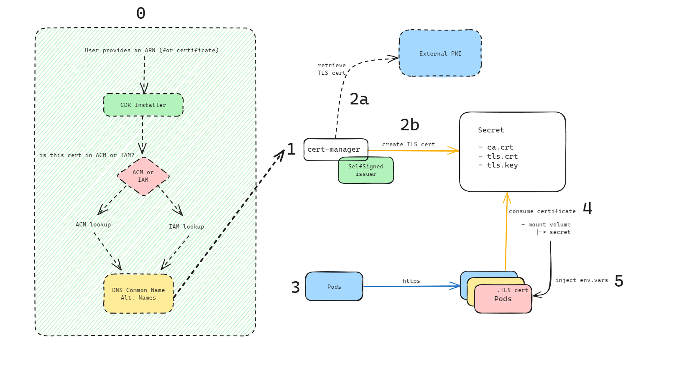

# Cert Manager, TLS and mTLS

## Motivation

The motivation for this process is to enable mutual TLS (mTLS) throughout the product's lifecycle, which is a security protocol that requires both the client and server to authenticate each other's identities before establishing a connection. This is a key component of "zero-trust" security architectures, where trust is never assumed and must be continually validated. In the context of Amazon Elastic Kubernetes Service (EKS), mTLS ensures that communications between pods, services, and external entities are authenticated and encrypted, aligning with zero-trust principles by verifying the identity of all communicating parties and securing the traffic within the cluster.

Cert-Manager is an OSS operator that helps facilitate creating and issuing certificates and bundles to requesting pod deployments and services. It automatically renews certificates and does this without application code changes. Applications should only need to mount the certificates/bundles in a predefined mount point in EKS. 

## Options

### Option 1: Self-Signed Certificates (see [this](#using-self-signed-certificates) for more info)

**Advantages**:
- Easy to implement and manage.
- No dependency on external Certificate Authorities (CAs).
- Cost-effective as there are no fees for certificate issuance or renewal.

**Disadvantages**: 
- Not trusted by external systems without manual trust establishment.
- Potential security risks if not managed properly.
- Limited to internal use cases where trust can be established out-of-band.

### Option 2: AWS Private CA

**Advantages**:
- Certificates issued by a trusted authority.
- Integration with AWS services and management tools.
- Ability to control and automate the certificate lifecycle.

**Disadvantages**:
- Higher cost due to AWS service fees.
- Customer control may lead to potential security concerns, such as the ability to decrypt traffic if certificates are mishandled.

### Option 3: Terminate TLS at the Load Balancer 

**Advantages**:
- Centralized management of TLS termination.
- Simplifies certificate management as certificates are only needed at the load balancer.
- Offloads encryption overhead from the pods to the load balancer.

**Disadvantages**: 
- Traffic between the load balancer and pods is not encrypted, which may not be suitable for sensitive data.
- Less granular control over encryption as all traffic is treated uniformly.

### Option 4: Terminate TLS at the Pod level

**Advantages**:
- Ensures end-to-end encryption of traffic.
- Provides the ability to enforce security policies at the pod level.
- Allows for different certificates and encryption standards for each pod.
- Proxy deals with certificates and application deals with application logic: separation adheres to the single responsibility principle.
- Maintaining security without disrupting the application.
- Sidecar proxy allows for a consistent approach to TLS termination across multiple services.

**Disadvantages**: 
- More complex certificate management as each pod requires its own certificate.
- Additional resource overhead on pods to handle encryption and decryption.
- Additional "hop".

## Solution

We looked at two options early on, and as we find out more information, `Option 2` is less likely to happen since PrivateCA actions are restricted by the customer. Ultimately `Option 1` satisifies the alpha release, but further work and considerations are needed to manage our own PKI infrastructure in the future. Alternatively a 'BYOC" (`bring your own cluster`) approach will put the responsibility of security (mTLS/TLS encryption) on the customer. In which case, a customer will assign the certificates for the product (services) to use. Another possible future-design looks like sharing the control and data planes with the customer, backed by auth0 for identity and access management, where we would configure the certificates and authorities, and customer just uses it. 

> Ultimately, the **proposed solution** for ease of deployment and management of the product deployment, is **Option 3**. 

---
### Using Self-Signed Certificates 

Once design choice is to use the `SelfSigned` issuer in conjunction with `cert-manager` operator. 
The `SelfSigned` issuer provided by `cert-manager` is a simple and powerful tool for generating self-signed certificates. Here are some key benefits of using the `SelfSigned` issuer in a Kubernetes environment:

1. **Ease of Setup**: The `SelfSigned` issuer allows for quick and easy setup of TLS certificates, which is particularly useful for development, testing, or internal applications where a certificate authority (CA) is not required.

2. **Cost-Effective**: Since no external CA is involved, there are no costs associated with purchasing or renewing certificates.

3. **Full Control**: You have complete control over the certificate generation process, including the ability to specify certificate details such as common names, subject alternative names, and validity periods.

4. **Mutual TLS (mTLS)**: Using `cert-manager` with `SelfSigned` issuers can facilitate mutual TLS communication between pods. mTLS ensures that both the client and server authenticate each other's certificates, providing a higher level of security by preventing unauthorized access and ensuring that both parties are who they claim to be.

5. **Automation**: `cert-manager` automates the process of issuing, renewing, and using certificates, which simplifies certificate management and reduces the potential for human error.

6. **Integration**: It integrates seamlessly with Kubernetes, allowing certificates to be used by Ingress controllers and other Kubernetes resources that require TLS.

By using the `SelfSigned` issuer with `cert-manager`, we can ensure that pods communicate securely with each other using mTLS, without the overhead of external CAs. This setup is ideal for scenarios where trust is established by other means within the cluster or for non-production use cases where ease of use is a priority.

### Self-Signed Issuer 

REF [SelfSigned](https://cert-manager.io/docs/configuration/selfsigned/)

Important to note here is that we will be using an Issuer and not a ClusterIssuer. The main difference between the two is that an Issuer can only issue certificates within the same namespace! If you want your CA to issue certificates in other namespaces as well, you will have to use the ClusterIssuer. See the cert-manager documentation for more info about this.
> Additionally, integrating Istio into our Kubernetes cluster enhances security and supports seamless mTLS configuration across services. Istio, in conjunction with Cert-Manager, simplifies certificate management within the service mesh, enabling automatic certificate rotation and streamlined mTLS setup. For detailed instructions on setting up Istio, refer to the [Istio Setup Documentation](docs/istio-setup.md).

---

### How Cert-Manager Works with our CDK installer 

---

### Creating Certificate Resources

Once a certificate is signed it will be stored in a `Secret` resource named the same as the `secretName` in the same namespace as the `Certificate` once the issuer has successfully issued the requested certificate. 

> Note: If you want to create an Issuer that can be referenced by Certificate resources in all namespaces, you should create a ClusterIssuer resource and set the certificate.spec.issuerRef.kind field to ClusterIssuer.

> Because certificate validation requires that root keys be distributed independently, the self-signed certificate that specifies the root certificate authority MAY be omitted from the chain, under the assumption that the remote end must already possess it in order to validate it in any case.

---
## AWS

### AWS EKS
When using a custom CNI (such as Weave or Calico) on EKS, the webhook cannot be reached by cert-manager. This happens because the control plane cannot be configured to run on a custom CNI on EKS, so the CNIs differ between control plane and worker nodes.

To address this, the webhook can be run in the host network so it can be reached by cert-manager, by setting the webhook.hostNetwork key to true on your deployment, or, if using Helm, configuring it in your values.yaml file.

Note that running on the host network will necessitate changing the webhook's port; see the warning at the top of the page for details.

### AWS Fargate

If you're using AWS Fargate or else if you've specifically configured cert-manager to run the host's network, be aware that kubelet listens on port 10250 by default which clashes with the default port for the cert-manager webhook.

As such, you'll need to change the webhook's port when setting up cert-manager.

**Amend the cert-manager.yaml file to change ports from 10250 to 10260**.

For installations using Helm, you can set the webhook.securePort parameter when installing cert-manager either using a command line flag or an entry in your values.yaml file.

If you have a port clash, you could see confusing error messages regarding untrusted certs. See [#3237](https://github.com/cert-manager/cert-manager/issues/3237) for more details.

### AWS Private CA Issuer

REF [PrivateCA](https://github.com/cert-manager/aws-privateca-issuer)

Usage with private ACM CA: https://aws.amazon.com/about-aws/whats-new/2022/01/acm-kubernetes-cert-manager-plugin-production/

---

### Assets 

Helm variables: https://artifacthub.io/packages/helm/cert-manager/cert-manager

Docker Images: https://quay.io/repository/jetstack/cert-manager-controller?tab=tags&tag=latest

### TLS Encryption 

https://aws.amazon.com/blogs/security/tls-enabled-kubernetes-clusters-with-acm-private-ca-and-amazon-eks-2/

### Best Practices

Network Requirements and Network Policy: https://cert-manager.io/docs/installation/best-practice/

---

### Commands 

`kubectl wait --for=condition=Ready=True clusterissuer selfsigned-cluster-issuer -n cert-manager`

`kubectl get clusterissuers -o wide selfsigned-cluster-issuer`

`kubectl wait --for=condition=Ready=True cert ca-certificate -n cert-manager`

`kubectl wait --for=condition=Ready=True clusterissuer ca-cluster-issuer -n cert-manager`

`kubectl wait --for=condition=Ready=True cert ca-certificate -n cert-manager`

#### Extract CA, cert, key
kubectl get secret -n cert-manager myingress-cert -o json | jq -r  '.data["ca.crt"]' | base64 -d > ca.crt
kubectl get secret -n cert-manager myingress-cert -o json | jq -r  '.data["tls.crt"]' | base64 -d > tls.crt
kubectl get secret -n cert-manager myingress-cert -o json | jq -r  '.data["tls.key"]' | base64 -d > tls.key

#### Extract cluster issuer CA
kubectl get secrets -n cert-manager test-ca -o json | jq -r '.data["tls.crt"]' | base64 -d > issuer.crt

diff issuer.crt ca.crt && echo "Issuing CA matches Ingress CA" || echo "Issuing CA doesn't match Ingress CA"

openssl verify -CAfile issuer.crt tls.crt