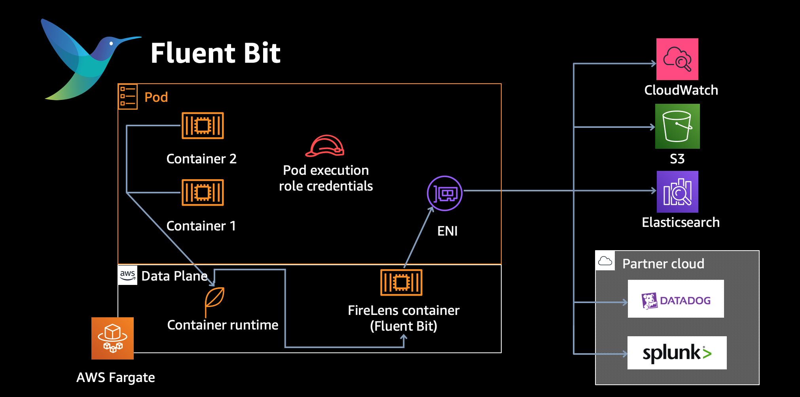
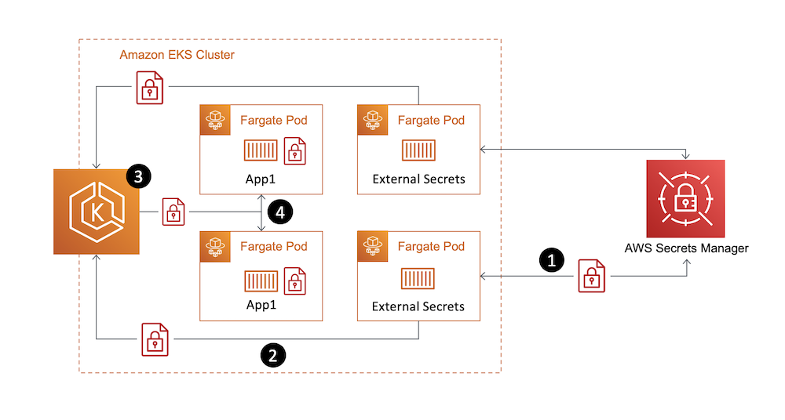

# Fargate

AWS Fargate Considerations [REF](https://docs.aws.amazon.com/eks/latest/userguide/fargate.html)

## Control 

Fargate gives you less control in various ways. Not only do you not control cluster sizing, but you also can’t specify configuration variables like HostPort and HostNetwork for containers running in Fargate mode. You also can’t run containers in privileged mode, and you can’t configure DaemonSets.

---

## Considerations

1. cert-manager 
2. fluent-bit
3. ALB 
4. Daemonsets
5. kube-proxy
6. secrets-operator
7. vpc-cni
8. affinity/anti-affinity
9. privileges 
10. pods on fargate networking requirements
11. DNS
12. EFS
---

1. Using cert-manager with fargate will work, so long as the webhook port is not using 10250, since kubelet listens on this. Change it to 10260. 

2. [fluent-bit](https://aws.amazon.com/blogs/containers/fluent-bit-for-amazon-eks-on-aws-fargate-is-here/) is automatically supported on EKS (no maintaining charts or images), just configure the log router to send `stdout` or `stderr` to CloudWatch. Under the hood, EKS on Fargate uses a version of Fluent Bit for AWS, an upstream conformant distribution of Fluent Bit managed by AWS. This means there are no sidecars to install or maintain. You simply select where you want to send your data and logs are routed to a destination of your choice.

3. EKS on Fargate with an ALB requires the use of Instance IP to map rules to pods. We cannot use Instance because Fargate is a serverless construct with no nodes, hence we rely on the IP of the pod. 

4. EKS on Fargate does not support using daemonsets. 

5. EKS on Fargate does not require kube-proxy to operate.

6. EKS on Fargate support for external-secrets operator [here](https://aws.amazon.com/blogs/containers/leverage-aws-secrets-stores-from-eks-fargate-with-external-secrets-operator/)

7. VPC CNI is installed on Fargate Nodes by default, and handled by the control plane. 

8. Kubernetes affinity/anti-affinity rules do not apply and aren't necessary with Amazon EKS Fargate Pods.

9. Privileged containers aren't supported on Fargate.

10. Pods that run on Fargate are only supported on private subnets (with NAT gateway access to AWS services, but not a direct route to an Internet Gateway), so your cluster's VPC must have private subnets available. For clusters without outbound internet access, see Private cluster requirements.

11. DNS resolution and DNS hostnames must be enabled for your VPC. For more information, see Viewing and updating DNS support for your VPC.

12. 