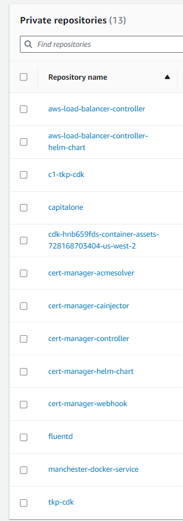

# Helm 

We will host images and helm charts in ECR. 

We want to install some helm projects: 
    - aws-load-balancer-controller
    - kubeview
    - cert-manager

Hosting in ECR looks like this: 

---

        # -------------------------------------------------------------------------------------------------------------
        # HELM CHART INSTALL: ingress-nginx ---------------------------------------------------------------------------
        # -------------------------------------------------------------------------------------------------------------
        add_ingress_nginx_chart = self.cluster.add_helm_chart(
            "ingress-nginx",
            repository=f"oci://{self.ecr_repo_url}/ingress-nginx-helm-chart",
            chart="ingress-nginx-helm-chart",
            version="v4.8.3",
            release="ingress-nginx",
            namespace="ingress-nginx",
            values={
                "controller": {
                    "image": {
                        "registry": f"{self.ecr_repo_url}",
                        "repository": "ingress-nginx-controller",
                        "tag": "v1.9.4",
                        "pullPolicy": "IfNotPresent",
                    },
                    "service": {
                        "annotations": {
                            "alb.ingress.kubernetes.io/load-balancer-name": "ingress",
                            "alb.ingress.kubernetes.io/target-type": "ip",
                            "alb.ingress.kubernetes.io/scheme": "internal",
                            "service.beta.kubernetes.io/aws-load-balancer-ssl-cert": self.certificate_arn,
                            "service.beta.kubernetes.io/aws-load-balancer-backend-protocol": "http",
                            "service.beta.kubernetes.io/aws-load-balancer-ssl-ports": "https",
                            "service.beta.kubernetes.io/aws-load-balancer-connection-idle-timeout": "3600",
                            "service.beta.kubernetes.io/aws-load-balancer-ssl-negotiation-policy": "ELBSecurityPolicy-TLS13-1-2-2021-06",
                        },
                        "targetPorts": {
                            "http": "http",
                            "https": "http",
                        },
                    },
                },
            },
        )